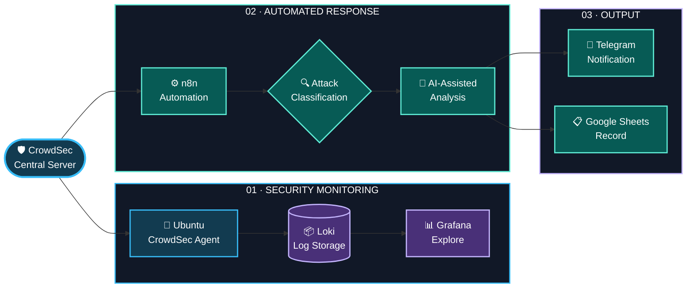
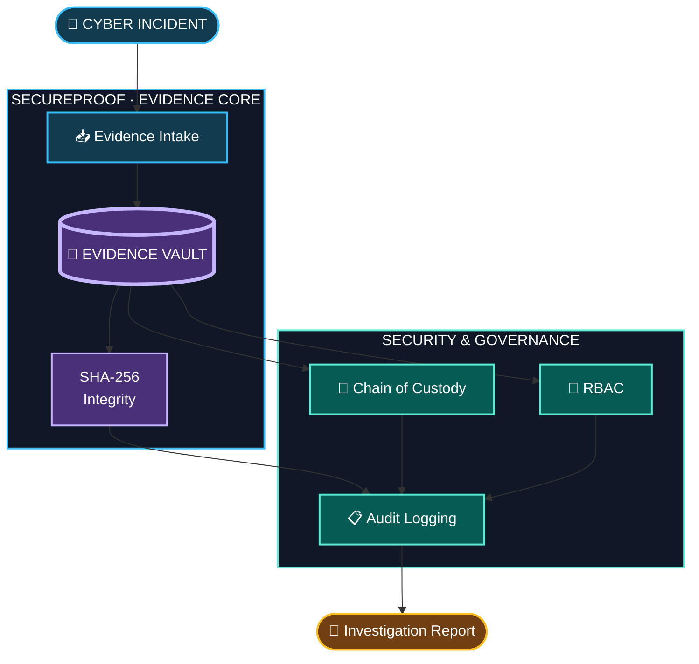

<h2>Cybersecurity • Networking • Network Infrastructure</h2>

<strong>Designing, configuring and securing practical technology environments.</strong>

---

## 👩‍💻 ABOUT ME

I am **Shraddha Rana**, with an academic background in BCA Cyber Security and practical exposure to cybersecurity, network infrastructure, Linux systems and security monitoring.

My focus is on understanding how systems communicate, how networks are configured, and how security controls can be implemented, tested and improved.

I enjoy practical technical work: configuring environments, investigating issues, validating results and documenting solutions.

### Core Areas of Interest

- 🌐 **Networking & Network Security:** Switching, routing fundamentals, VLANs, LAN/WAN and network troubleshooting.
- 🛡️ **Cybersecurity Operations:** Vulnerability assessment, log analysis, intrusion detection and security monitoring.
- 🐧 **Systems & Infrastructure:** Linux administration, virtualization, service configuration and container-based environments.
- ⚙️ **Security Engineering:** Threat monitoring and automation, digital evidence integrity and static malware investigation.

**Experience:** Cybersecurity Intern — Sentrolis InfoSec, Surat

**Education:** BCA Cyber Security — SDJ International College, Surat, Gujarat, India

---

## 🧭 TECHNICAL DOMAINS

<table>
<tr>
<th align="center" width="33%">🌐 NETWORKING</th>
<th align="center" width="33%">🛡️ SECURITY</th>
<th align="center" width="33%">🖥️ SYSTEMS</th>
</tr>
<tr>
<td align="center">

**Switching & Routing**

**VLAN Fundamentals**

**LAN / WAN**

**pfSense**

**Proxmox Networking**

**Network Troubleshooting**

</td>
<td align="center">

**Vulnerability Assessment**

**Network Security**

**Intrusion Detection**

**Log Analysis**

**Security Monitoring**

**Digital Evidence**

</td>
<td align="center">

**Linux Administration**

**Docker**

**Virtualization**

**Service Configuration**

**Monitoring**

**Automation**

</td>
</tr>
</table>

---

## 🧰 TECHNOLOGY STACK

### NETWORKING & INFRASTRUCTURE

 

### CYBERSECURITY & MONITORING

 

### DEVELOPMENT & AUTOMATION

 

---

## 🚀 FEATURED PROJECTS

### 🔷 NETRIS — Network Threat Response & Intelligence System

An integrated network threat monitoring and response project that combines security event collection, threat classification, log storage, visualization and automated notifications.

**Key Components**

- CrowdSec Central Server and Ubuntu Agent
- Loki Log Aggregation
- Grafana Monitoring and Visualization
- Prometheus Metrics
- n8n Workflow Automation
- Attack Classification and AI-Assisted Analysis
- Telegram Notifications and Google Sheets Records

**Project Focus:** Integrating security monitoring components into a practical workflow for collecting, reviewing and responding to suspicious activity.

---

### 🟣 SecureProof — AI-Based Cyber Incident Evidence & Compliance Platform

A platform designed to preserve digital evidence, verify integrity, maintain traceability and support incident investigation and compliance workflows.

**Key Components**

- Python and Flask
- REST API Integration
- SHA-256 Evidence Integrity Verification
- Evidence Manifest
- Chain of Custody Tracking
- TOTP Multi-Factor Authentication
- Role-Based Access Control
- Audit Logging and n8n Automation

---

### 🟠 MalGraphX — AI-Powered Malware Investigation & Threat Intelligence Platform

A static malware investigation platform designed to support analysis without executing suspicious samples.

**Key Components**

- Static PE Analysis
- YARA Rule Matching
- IOC Extraction
- MITRE ATT&CK Mapping
- Sysmon Log Analysis
- User-Initiated VirusTotal Hash Lookup
- PDF Report Generation
- AI-Assisted Investigation

---

### 🔵 Network & Infrastructure Labs

Practical configuration and troubleshooting exercises focused on networking and system infrastructure.

- Cisco Packet Tracer Switching and VLAN Configuration
- Routing Fundamentals and LAN/WAN Concepts
- Proxmox Networking and Virtual Machines
- FreePBX 17 and SIP Configuration
- Linux Server Administration
- Firewall and Network Troubleshooting

---

## 📡 NETRIS — SYSTEM ARCHITECTURE

**Security Event Processing • Log Aggregation • Monitoring • Automated Notification**

---

## 🧾 SECUREPROOF — EVIDENCE WORKFLOW

**Evidence Intake • Integrity Verification • Chain of Custody • Auditability**

---

## 💼 PROFESSIONAL EXPERIENCE

### Cybersecurity Intern — Sentrolis InfoSec

**Surat, Gujarat, India | May 2026 | One-month internship**

Completed practical cybersecurity internship activities involving vulnerability assessment, web security testing, security monitoring and network security lab exercises.

| Area | Practical Exposure |
|:---|:---|
| Vulnerability Assessment | Nessus credentialed and non-credentialed scans |
| Web Security | OWASP ZAP testing and mitigation exercises |
| SIEM | Splunk log analysis |
| Firewall | pfSense |
| Intrusion Detection | Suricata |
| Threat Monitoring | CrowdSec |
| Visualization | Grafana |

---

## 📚 CURRENT LEARNING & DEVELOPMENT

| Focus Area | Topics |
|:---|:---|
| 🌐 Networking | Switching, Routing, VLANs, LAN/WAN |
| 🔐 Network Security | Firewalls, Segmentation, Network Protection |
| 🐧 Linux | Administration, Services, Troubleshooting |
| 🖥️ Virtualization | Proxmox and Virtual Infrastructure |
| ☎️ VoIP | FreePBX and SIP Configuration |
| 📊 Monitoring | Logs, Metrics and Observability |

---

## ⚙️ MY APPROACH

<h3>Practical knowledge. Clear documentation. Continuous improvement.</h3>

---

## 🤝 CONNECT WITH ME

<!-- Add your verified LinkedIn profile URL here when ready. -->

  

<h3>Building practical knowledge, one system at a time.</h3>

